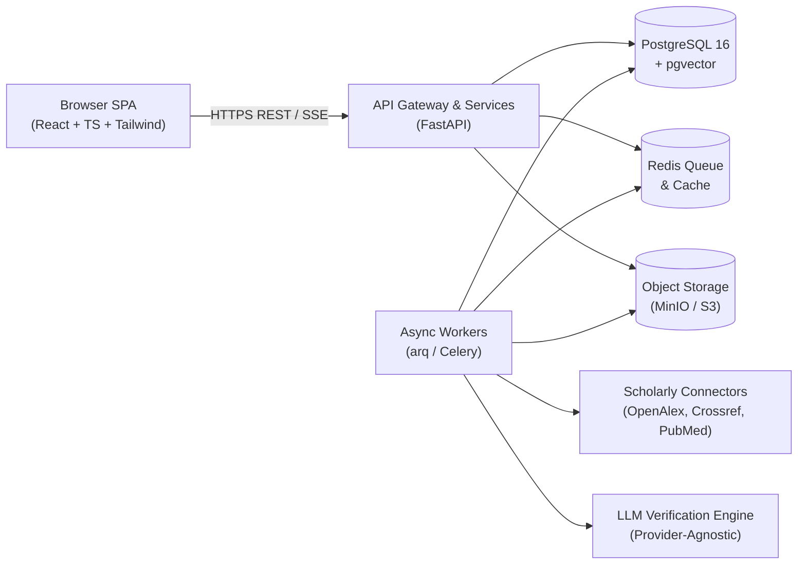

# Architecture & Data

Gate-Status: APPROVED | Approved-By: user | Date: 2026-10-24

## B1. System Overview
- **Style:** Modular Layered Client-Server Architecture (FastAPI async REST + SSE backend, React 19 + TypeScript + Vite + Tailwind CSS frontend, PostgreSQL 16 + pgvector relational/vector store, Redis job queue).
- **Components & boundaries:**
  - `apps/web`: SPA UI, state management (TanStack Query), interactive visualizers (lineage DAG, PRISMA flowchart, screening workbench).
  - `apps/api`: FastAPI application organized into 14 bounded context modules (`identity`, `projects`, `sources`, `works`, `library`, `screening`, `retrieval`, `synthesis`, `integrity`, `journals`, `mapping`, `jobs`, `billing_quota`, `audit`).
  - `PostgreSQL 16 + pgvector`: Primary persistence for relational entities, audit logs, full-text indexes, and chunk vector embeddings.
  - `Redis + arq/Celery`: Background job orchestration for heavy connector fan-out, citation graph crawling, and RAG chunk extraction.
  - `Object Storage (MinIO / S3)`: Dedicated storage for uploaded PDFs and export artifacts; tenant-isolated.
- **Diagram:**


## B2. Technology Stack
Exact versions from lockfiles/manifests and blueprint contracts (blueprints/02-architecture.md):
| Layer | Choice | Version | Evidence (file) |
| :--- | :--- | :--- | :--- |
| Language | Python & TypeScript | Python 3.11+ / Node 20+ (TS 5.4+) | blueprints/02-architecture.md |
| UI / Frontend | React + Vite + Tailwind CSS | React 18/19, Vite 5.x, Tailwind 3.4+ | blueprints/02-architecture.md |
| Backend / API | FastAPI + Pydantic v2 + SQLAlchemy 2.0 | FastAPI 0.111+, Pydantic 2.7+, SQLAlchemy 2.0+ | blueprints/02-architecture.md |
| Database | PostgreSQL + pgvector + pg_trgm | PostgreSQL 16, pgvector 0.7+ | blueprints/03-data-model.sql |
| Realtime | Server-Sent Events (SSE) | FastAPI StreamingResponse | blueprints/04-openapi.yaml |
| Testing | Pytest + Playwright (Cua harness) | Pytest 8.x, Playwright 1.44+ | blueprints/08-test-strategy.md |
| Design system | Warm Editorial (ResearchForge custom tokens) | Custom (Stone/Parchment/Amber/Indigo) | prototype/standalone/main.html |

## B3. Request Lifecycle
Path of one state-changing operation (e.g. screening decision or synthesis execution):
1. UI trigger -> optimistic pending state, button debounced/disabled to prevent double submit.
2. Client validation via TypeScript interfaces / Zod schemas.
3. Gateway & FastAPI middleware: correlation ID injection, security headers, rate limiting.
4. Authentication verification via secure HTTP-only session cookie (401 if unauthenticated).
5. Authorization check: Project RBAC verification (Owner, Reviewer, Viewer) preventing IDOR (403 if unauthorized).
6. Server input validation: Pydantic v2 models validate and strip extraneous fields (422 with detailed field errors).
7. Service logic execution within an async database transaction.
8. Background job dispatch to Redis queue (e.g. embedding, connector fan-out) and SSE event broadcast.
9. Typed JSON response envelope returned -> UI cache invalidation & optimistic update reconciliation.
- **Failure handling:** External connector timeouts capped at 8 s with exponential backoff (max 3 retries); database connection pool exhaustion triggers HTTP 503; synthesis verification failures gracefully fall back to raw retrieved chunks with explicit unsupported flags.

## B4. Data Model
Exact 38 relational entities from blueprints/03-data-model.sql:
| Entity | Fields (type, constraints) | Relations / indexes |
| :--- | :--- | :--- |
| `users` | id (uuid pk), email (varchar unique), full_name, created_at | Users table for identity & session ownership |
| `projects` | id (uuid pk), name, description, owner_id (fk users), created_at | Root tenant boundary for all project-scoped entities |
| `project_members` | project_id (fk), user_id (fk), role (owner/reviewer/viewer) | Composite PK (project_id, user_id) |
| `works` | id (uuid pk), doi (unique nullable), title, abstract, year, venue, type | Canonical public scholarly metadata store |
| `authors` | id (uuid pk), name, orcid (nullable) | Normalized author index |
| `work_authors` | work_id (fk), author_id (fk), position | Composite PK (work_id, author_id) |
| `work_citations` | citing_work_id (fk), cited_work_id (fk) | Citation graph directed edges |
| `journals` | id (uuid pk), issn, title, publisher, sjr, quartile, apc_usd, oa_type | Journal master index for fit matching |
| `library_items` | id (uuid pk), project_id (fk), work_id (fk), added_by, notes | Project library membership (tenant-scoped) |
| `collections` | id (uuid pk), project_id (fk), name, parent_id | Hierarchical folder structure |
| `collection_items`| collection_id (fk), library_item_id (fk) | Many-to-many collection mappings |
| `tags` | id (uuid pk), project_id (fk), name, color | Project taxonomy tags |
| `library_item_tags`| library_item_id (fk), tag_id (fk) | Many-to-many item tags |
| `import_batches` | id (uuid pk), project_id (fk), source, total_count, status | Batch import metadata (RIS/BibTeX/OpenAlex) |
| `user_files` | id (uuid pk), project_id (fk), filename, storage_key, mime_type | Tenant-scoped PDF attachments |
| `dedup_candidates`| id (uuid pk), project_id (fk), work_a_id, work_b_id, confidence | Deduplication review queue |
| `review_protocols`| id (uuid pk), project_id (fk), question, pico_json, criteria | Systematic review protocol definition |
| `exclusion_reasons`| id (uuid pk), project_id (fk), code, label | Controlled vocabulary for screening exclusions |
| `screening_decisions`| id (uuid pk), project_id (fk), work_id (fk), user_id (fk), stage, decision | Immutable append-only audit log for PRISMA |
| `screening_resolutions`| id (uuid pk), project_id (fk), work_id (fk), resolved_by, decision | Third-party conflict resolution log |
| `ai_suggestions` | id (uuid pk), project_id (fk), work_id (fk), suggestion, confidence | Non-authoritative AI screening guidance |
| `chunks` | id (uuid pk), work_id (fk), chunk_index, text, embedding (vector) | Chunked scholarly text with pgvector embeddings |
| `extractions` | id (uuid pk), project_id (fk), work_id (fk), population, method, finding | Structured evidence extraction tables |
| `synthesis_runs` | id (uuid pk), project_id (fk), query, synthesis_text, status | Grounded RAG synthesis runs |
| `synthesis_run_chunks`| synthesis_run_id (fk), chunk_id (fk), claim_index, verified | Citation-to-chunk provenance audit log |
| `ai_usage_log` | id (uuid pk), project_id (fk), feature, model, tokens_in, tokens_out | Granular audit trail for AI disclosure statement |
| `reference_checks`| id (uuid pk), project_id (fk), doi, status (valid/retracted/unresolved) | Retraction and DOI validation log |
| `jobs` | id (uuid pk), type, status, payload_json, result_json, error | Background task tracking |
| `usage_quota` | user_id (fk), weekly_token_cap, tokens_used, reset_at | Per-user rate and cost caps |
| `audit_events` | id (uuid pk), project_id (fk), user_id (fk), action, metadata_json | Comprehensive system event log |
| `source_cache` | key (text pk), source, payload_json, expires_at | External API cache for rate-limit protection |
| `map_runs` | id (uuid pk), project_id (fk), params_json, status | Topic & family clustering runs |
| `map_clusters` | id (uuid pk), map_run_id (fk), label, size, centroid (vector) | Research family clusters |
| `map_cluster_members`| map_cluster_id (fk), work_id (fk) | Cluster membership |
| `lineage_nodes` | id (uuid pk), project_id (fk), work_id (fk), cluster_id, year | Lineage DAG node representation |
| `lineage_edges` | id (uuid pk), project_id (fk), source_work_id, target_work_id, score | Scored genealogical lineage edges |
| `positioning_runs`| id (uuid pk), project_id (fk), manuscript_title, top_parents_json | Manuscript genealogical positioning runs |
| `gap_signals` | id (uuid pk), project_id (fk), work_id (fk), signal_type, excerpt | Extracted research gap signals |
- **Migration strategy:** Forward-only migrations managed via Alembic; reversible rollbacks tested in staging.
- **Test data policy:** Isolated in-memory SQLite or ephemeral Postgres containers; all synthetic fixtures tagged `# SYNTHETIC TEST FIXTURE`. Production database strictly contains zero synthetic mock data.

## B5. Dependency Rules
- **Allowed import direction:** `apps/web` -> `apps/api/routers` -> `apps/api/services` -> `apps/api/repositories` -> `apps/api/models` (SQLAlchemy) & Database.
- **Forbidden:** Core domain services importing API presentation/router layers; database models calling API routers; UI directly communicating with database or executing SQL.
- **Third-party packages:** All new dependencies require explicit justification and ADR entry before addition.
- **Module/folder layout:**
  ```
  researchforge/
  ├── apps/
  │   ├── api/             # FastAPI backend (14 modular domains)
  │   │   ├── app/
  │   │   │   ├── identity/
  │   │   │   ├── projects/
  │   │   │   ├── works/
  │   │   │   ├── library/
  │   │   │   ├── screening/
  │   │   │   ├── synthesis/
  │   │   │   ├── mapping/
  │   │   │   └── ...
  │   │   └── tests/
  │   └── web/             # React 19 + TypeScript + Vite SPA
  │       ├── src/
  │       │   ├── components/
  │       │   ├── pages/
  │       │   ├── hooks/
  │       │   └── lib/
  │       └── tests/
  ├── blueprints/          # Authoritative specifications (00-15)
  ├── prototype/standalone/# Interactive HTML/JS mockups
  └── .agents/             # PRD.md, ARCHITECTURE.md, LEDGER.md
  ```

## Change Log
| Date | Change | Requested by |
| :--- | :--- | :--- |
| 2026-10-24 | Initial architecture specification synthesized from blueprints (02-architecture.md, 03-data-model.sql, 04-openapi.yaml) | Antigravity Orchestrator |
