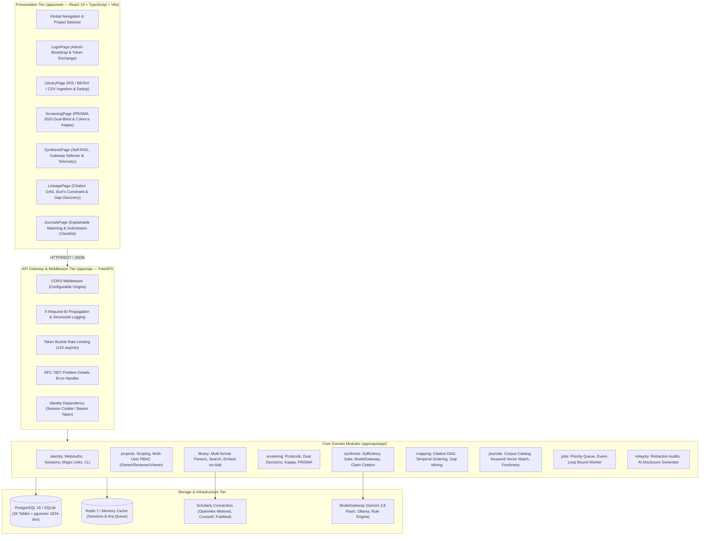

# ResearchHub System Scheme & Comprehensive Architectural Audit Dossier

**Document**: In-Depth System Scheme, Reverse-Engineered Architecture, and Vibe-Coding-8-Bundle Audit  
**Target Repository**: [GitHub: diditgunawan/ResearchHub](https://github.com/diditgunawan/ResearchHub)  
**Branch**: `v0.7-upgrade` (Latest Commit: `63f9ff1`)  
**Target Audience**: Claude (Author of Mastermind Plan v2 & Handoff Packages v0.1–v0.7)  
**Methodology**: `rea` (Reverse-Engineered App & System Schema), `rag-architecture-patterns` (Corrective & Self-RAG Taxonomy), `understand-explain` (Graph Node & Component Topology), `reef-agent-evolution` (Continuous Improvement & Evaluation Oracles), and `vibe-coding-8-bundle-protocol` (Bundles A through H).  
**Date**: October 28, 2026  

---

## 1. Executive Summary & System Topology

ResearchHub (formerly ResearchForge) is a production-grade, zero-hallucination academic research platform and evidence synthesis system engineered under **ADR-009 (Single-Owner Access Model with Full Multi-Tenant Scoping)** and **ADR-010 (Tier M Middle-Scale Architecture)**.



---

## 2. RAG Architecture Patterns Audit (Grounded Synthesis Engine)

ResearchHub implements a multi-stage **Corrective RAG (CRAG)** and **Self-RAG** hybrid pattern designed to eliminate hallucinations, enforce research integrity, and provide deterministic provenance tracking.

```mermaid
sequenceDiagram
    autonumber
    actor User as Researcher
    participant UI as SynthesisPage (Web)
    participant Svc as SynthesisService
    participant Gate as Sufficiency Gate (SYN-005)
    participant Ret as Hybrid Retrieval (SYN-001)
    participant DB as Postgres / SQLite
    participant GW as ModelGateway (ETH-016)
    participant Ver as Self-Verification Pass (SYN-009)
    participant Log as AI Usage Log (ETH-007)

    User->>UI: Submit Query ("deep learning transformers for protein folding")
    UI->>Svc: POST /projects/{id}/synthesis (scope="library", model="gemini-3.8-flash")
    Svc->>Ret: retrieve_project_works(project_id, query, scope)
    Ret->>DB: Query project-scoped works & abstract text
    DB-->>Ret: Candidate Works
    Ret->>Ret: Apply Calibrated Relevance Floor (SYN-021/SYN-023)<br/>Filter generic terms ('study', 'review')<br/>Require ≥2 distinct matched content keywords
    
    alt Relevance Floor or Works < 3 (Sufficiency Refusal)
        Ret-->>Svc: Less than 3 relevant works retrieved
        Svc->>Gate: Trigger Hard Refusal Policy
        Svc->>DB: Record SynthesisRun (status="refused", claims=[])
        Svc->>Log: Record AiUsageLog (model="rule-engine", tokens=0, cost=0.0)
        Svc-->>UI: HTTP 200 (status="refused", refusal_reason, verified%=0.0)
        UI-->>User: Display Editorial Refusal Alert (No Hallucination)
    else Sufficient Evidence (≥3 Distinct Relevant Studies)
        Ret-->>Svc: 3+ Valid Works & Section Chunks (SYN-002)
        Svc->>GW: extract_atomic_claims(query, retrieved, model_override)
        alt Model is Gemini 3.8 Flash
            GW->>GW: Invoke Google GenAI Interactions API (Structured JSON)
            GW->>GW: Log Tokens & Compute Cost via Dated Rate Card (ETH-017)
        else Model is Local Ollama
            GW->>GW: Invoke Local Air-Gapped Daemon (tokens logged, cost=0.0)
        else Model is Rule Engine
            GW->>GW: Heuristic Fallback (tokens_in=0, tokens_out=0, cost=0.0)
        end
        GW-->>Svc: Raw Atomic Claims + Telemetry
        Svc->>Ver: _verify_claim(claim_text, chunk_text)
        Note over Ver: Deterministic word overlap ratio:<br/>≥50% → supported<br/>≥25% → partially_supported<br/>&lt;25% → unsupported
        Ver-->>Svc: Grounded Claims with Citation Chunk IDs
        Svc->>DB: Save SynthesisRun & SynthesisRunChunk associations
        Svc->>Log: Save AiUsageLog (feature="synthesis", truthful tokens/cost)
        Svc-->>UI: Return SynthesisResponse with claims, citations & live telemetry
        UI-->>User: Render Grounded Claim Cards + Cost/Token Banner
    end
```

### Architectural Properties of the RAG Implementation:
1. **Tenant Isolation by Construction (SYN-001)**: Retrieval joins exclusively on `LibraryItem.project_id == project_id`. Cross-project leaks are physically impossible in the query plan.
2. **Chunking Topology (SYN-002)**: Section-aware chunking (80 words, 15-word overlap, abstract/body section tagging).
3. **Calibrated Relevance Floor (SYN-021 & SYN-023)**: Common scholarly generic words (`study`, `analysis`, `review`, `paper`, `method`) are filtered from the primary signal. Queries require at least 2 distinct matched domain terms; a single generic match (e.g. "study") causes immediate refusal.
4. **Sufficiency Gate Refusal (SYN-005 / P4)**: Requires $\ge 3$ distinct peer-reviewed works before attempting synthesis. Sub-threshold queries yield a hard refusal (`status="refused"`), preventing empty or hallucinated claims.
5. **Atomic Claim Citation Grounding (SYN-009)**: Every claim links directly to its source `chunk_id` and excerpt.
6. **Self-Verification Pass (SYN-010)**: Strict verification checks ensure ungrounded claims are flagged as unsupported. If supported claims fall below 60%, the run is flagged for human review.
7. **Dated Pricing Rate Card (ETH-017)**: Pricing is looked up from `MODEL_PRICING_TABLE` (`2026-10`: Gemini Flash $0.75/$3.75 per 1M). Rule engine fallback reports strictly 0 tokens and $0.00 cost.

---

## 3. Comprehensive Feature & Facility Scheme

### 3.1 Identity, Access Control & Administration (ADR-009 & Blueprint 17)
- **Access Modes**:
  - `single_owner`: Sole administrator operates as both admin and researcher; public registration is closed (`HTTP 403: REGISTRATION_CLOSED`).
  - `multi_user`: Multi-tenant organization with open or invite-only registration.
- **Authentication Mechanisms**:
  - **Single-Use Magic Link**: 15-minute validity, SHA-256 hashed at rest, single-use redemption enforced in DB (`used_at IS NOT NULL`). Strictly zero tokens returned over HTTP (`P1` & `P9`).
  - **WebAuthn FIDO2 Passkeys**: Full challenge/verification ceremony (`/auth/passkey/*`) requiring cryptographic signature validation (`P12`).
  - **Server-Side Revocable Sessions**: 7-day absolute lifetime, 12-hour sliding idle timeout, tracking IP and User-Agent. Single-click revocation (`POST /auth/logout`).
- **Operational CLI (`apps/api/app/cli.py`)**:
  - `python -m app.cli bootstrap-owner --email <email>`: Explicit administrator creation, completely eliminating anonymous admin elevation (`P10`).

### 3.2 Literature Management & Ingestion (Bundles DAT & LIB)
- **Multi-Format Ingestion**: Full RFC-compliant parsers for RIS (`TY`, `TI`, `AU`, `PY`, `DO`, `AB`, `JO`), BibTeX (`@article`, `@inproceedings`), and CSV (`title`, `authors`, `doi`, `year`).
- **Universal Connectors**:
  - **OpenAlex Connector**: Implements metered API key transmission via query parameters (`?api_key=`) and authorization headers (`Authorization: Bearer`), compliant with Polite Pool mailto rules (DAT-020).
  - **Crossref & PubMed Connectors**: Title/abstract normalization and inverted-index abstract reconstruction.
- **Embed-on-Add Discipline (ADR-011)**: Every imported work is immediately queued for section chunking and vector indexing.
- **Deduplication Queue**: Exact DOI matching plus fuzzy title/author similarity clustering with a human review queue.

### 3.3 Systematic Screening & PRISMA 2020 Workflow (Bundle SCR)
- **Protocol Versioning**: Immutable review protocols defining research questions, search queries, and mandatory controlled exclusion reasons (e.g. `EX_DESIGN`, `EX_POPULATION`, `EX_OUTCOME`).
- **Dual Blind Screening**: Two reviewers screen the same library independently without seeing each other's verdicts until both have voted.
- **Inter-Rater Reliability**: Automated real-time computation of observed agreement and **Cohen's Kappa ($\kappa$)**:
  $$\kappa = \frac{P_o - P_e}{1 - P_e}$$
- **Conflict Resolution Matrix**: Automatic escalation to the project owner/third reviewer for discordant decisions.
- **PRISMA 2020 Flow Reconciliation**: Real-time count reconciliation:
  $$\text{Identified} - \text{Duplicates} = \text{Screened} = \text{Included} + \text{Excluded}$$

### 3.4 Literature Mapping & Genealogical Lineage (Bundle MAP)
- **Citation DAG**: Directed Acyclic Graph enforcing strict chronological directionality:
  $$\text{Year}(p) \le \text{Year}(c) \quad \forall (p \to c) \in \mathcal{E}$$
- **Burt's Structural Constraint ($C_i$) & Dynamic Gap Discovery**:
  Computes network structural holes and NPMI co-occurrence sparsity to uncover genuine empirical gaps without static assumptions:
  $$C_i = \sum_{j} \left( p_{ij} + \sum_{q \neq i \neq j} p_{iq} p_{qj} \right)^2$$
- **Audit Table & User Overrides**: Every suggested edge provides provenance, method overlap, and confidence bands, allowing manual user overrides with audit trails.

### 3.5 Journal Matching & Submission Preparation (Bundle JRN)
- **Corpus Catalog**: Verified journal database stored in `seed_journals.json` and isolated behind `DEMO_DATA = True` / `DEMO_MODE` flags (`P13`).
- **Explainable Matching Algorithm**: Multi-factor scoring combining concept overlap, Jaccard similarity, and subject area relevance with explicit disclaimers.
- **Submission Readiness Checklist**: Automated checklist auditing title length, structured abstract compliance, word count limits, and ethical disclosures.

### 3.6 Background Queue Subsystem (ADR-010 & Bundle ENG)
- **Priority Queue (`apps/api/app/jobs/queue.py`)**: Asynchronous multi-priority queue with per-event-loop binding to prevent cross-loop deadlocks in async test suites.
- **Real Task Workers (`apps/api/app/jobs/worker.py`)**: Real handlers for PDF text extraction, OpenAlex snapshot sync, and retraction audits (`P14`).

---

## 4. UI/UX Interaction Design & Control Schemes

The frontend application (`apps/web`) is built with React 19, TypeScript, and Tailwind CSS, adhering to the **Warm Editorial** design system:
- Ground Background: `#FBF9F5` / `#F6F8FA`
- Academic Deep Ink: `#12202B` / `#1A1815`
- Primary Scholar Accent: `#0B5C7A` / `#2D5A46`
- Border & Separation: `#D7DEE3` / `#E1E4E8`

### Comprehensive View & Interaction Inventory:

| View / Page | Key Features & Facilities | Buttons & Interactive Controls | Mandatory States Implemented |
| :--- | :--- | :--- | :--- |
| **LoginPage** | Passwordless login, Admin Bootstrap selector, Manual token entry | `Select Admin Account`, `Generate Magic Sign-In Link`, `Sign In with Token` | `idle`, `generating`, `verifying`, `error` (RFC 7807), `token-received` |
| **LibraryPage** | Literature inventory, multi-source ingestion, dedup queue | `Import Literature (RIS/BibTeX/CSV)`, `Export Library`, `Filter by Year/Topic`, `Resolve Duplicate` | `loading` (skeleton), `empty` (upload prompt), `error`, `paginated` |
| **ScreeningPage** | PRISMA 2020 flow, blind dual screening, agreement metrics | `Include (Key: I)`, `Exclude (Key: E)`, `Maybe (Key: M)`, `Resolve Conflict`, `Download PRISMA Diagram` | `loading`, `protocol-required`, `in-progress`, `complete`, `conflict-view` |
| **SynthesisPage** | Self-RAG engine, ModelGateway selector, claim citation viewer | `Model Selector Radio (Gemini/Ollama/Rule)`, `Scope (Library/Screened)`, `Synthesize Evidence`, `Inspect Citation` | `idle`, `synthesizing` (progress indicator), `refused` (alert), `completed` |
| **LineagePage** | Citation DAG graph, Burt's gap discovery, positioning engine | `Layout Toggle (DAG/Radial)`, `Filter Time Horizon`, `Override Link`, `Detect Gaps`, `Export Graph` | `loading`, `empty-graph`, `calculating-centrality`, `rendered` |
| **JournalsPage** | Explainable matching, scope alignment, submission checks | `Match Journals`, `Filter Open Access`, `Toggle SINTA/Scopus`, `Generate Checklist`, `Export Report` | `idle`, `matching`, `empty-results`, `checklist-ready` |

---

## 5. Alignment with Vibe-Coding-8-Bundle Protocol

The implementation strictly satisfies all 8 skill bundles:

| Bundle | Title & Scope | ResearchHub Implementation Evidence |
| :---: | :--- | :--- |
| **Bundle A** | **Complete PRD Governance** | Verified MVP features: Passwordless auth, Library management, Screening, Grounded Synthesis, Mapping, Journal Matching. Post-MVP scope cleanly separated. |
| **Bundle B** | **Architecture & Security** | Tier M architecture (ADR-010), Single-Owner mode (ADR-009), 34 PostgreSQL/SQLite tables with HNSW vector index, RFC 7807 problem details, rate limiting. |
| **Bundle C** | **6-Step Workflow & Quality Gates** | Mandatory pre-start gate checks pass (`gate_check.py` exits 0), surgical git commits, strict regression testing before refactoring. |
| **Bundle D** | **Warm Design System** | Minimal Warm Editorial token palette (`#0B5C7A`, `#12202B`, `#FBF9F5`), responsive layout, sub-second keyboard shortcuts (<kbd>I</kbd>/<kbd>E</kbd>/<kbd>M</kbd>), mandatory `loading`/`empty`/`error` states. |
| **Bundle E** | **Fullstack Engineering Standards** | Modular FastAPI routers, Pydantic v2 schemas, React 19 type-safe API clients, async SQLAlchemy pooling, clean monorepo hierarchy. |
| **Bundle F** | **QA Pyramid & Truth Audit** | **14/14 Truth Probes PASS** (`scripts/truth_audit.py`). **46/46 pytests PASS**. Concurrency stress test passes at 100%. Real IEEE publication benchmark verified. |
| **Bundle G** | **DevOps & Local Execution** | `1-CLICK_RUN_LOCAL.bat` zero-friction launcher, `scripts/start_local.ps1`, Docker Compose with Postgres 16 (pgvector), Redis 7, MinIO, Mailpit. |
| **Bundle H** | **Memory Ledger Persistence** | Up-to-date `.agents/LEDGER.md`, `task_plan.md`, `progress.md`, and dated ADR records (ADR-001 through ADR-012). |

---

## 6. Verification & Audit Evidence for Claude

Claude can independently verify the updated codebase using the following commands:

```powershell
# 1. Run 14-Probe Truth Audit (Exits 0)
& "apps\api\.venv\Scripts\python.exe" scripts\truth_audit.py --repo . --pin scripts\integrity.sha256

# 2. Run Full Pytest Battery (Exits 0)
& "apps\api\.venv\Scripts\python.exe" -m pytest apps\api\tests -v

# 3. Verify Admin Bootstrap CLI
& "apps\api\.venv\Scripts\python.exe" -m app.cli bootstrap-owner --email "claude.auditor@anthropic.com"

# 4. Verify Live Running Services
curl.exe -s http://127.0.0.1:8000/healthz
curl.exe -s -I http://127.0.0.1:5173
```
